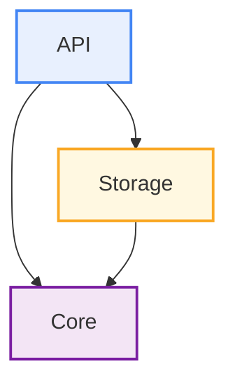
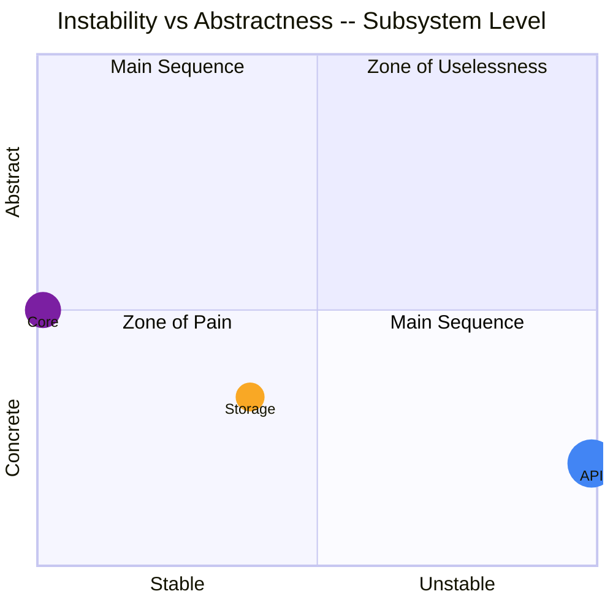
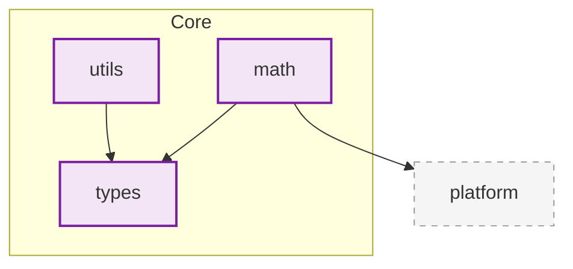

# Architecture Assessment Definition

Definition for writing architecture assessment documents. An arch-assessment is a dated measurement of a component's structural health. It extracts the dependency graph, computes coupling and volatility metrics, detects structural problems (cycles, zone violations), and presents findings at three levels of detail. Its value is in the objective measurement -- the architecture as observed -- not in prescriptions for what to change.

---

## 1. Purpose

An arch-assessment exists to:

1. **Measure** -- extract the dependency structure and compute metrics that quantify coupling, abstractness, stability, and volatility.
2. **Surface** -- identify structural problems (cycles, zone violations, risk concentrations) unconditionally, regardless of whether they are new or previously reported.
3. **Orient** -- present the architecture at three levels of detail so that a reader can understand the system's structure from subsystem groupings down to individual build targets.
4. **Inform** -- provide the evidence that drives refactoring decisions. The assessment is the diagnostic report; briefs and plans are the treatment.

An arch-assessment is NOT:

- An arch-design. An arch-design defines the intended architecture -- types, contracts, decomposition. An arch-assessment measures the implemented architecture. They are complementary: the arch-design states intent; the assessment measures reality. See [Architecture Design Definition](arch-design_definition.md).
- A design study. A design study explores alternatives and converges on a recommendation. An assessment observes and reports. See [Design Study Definition](design-study_definition.md).
- A plan. A plan sequences implementation work. Findings in the assessment may motivate a plan, but the assessment does not prescribe how to sequence the work. See [Implementation Plan Definition](impl-plan_definition.md).
- A one-time report. Each assessment is an immutable snapshot, but the practice is ongoing. When the architecture changes, generate a new snapshot. The latest snapshot is the current state.

---

## 2. Principles

### 2.1. Observation with Diagnosis

The assessment reports what the architecture looks like, diagnoses the nature of each problem using the (I, A) quadrant classification, and recommends intervention classes for prioritized components. "Planning is rigid -- extract interfaces for the scoring vocabulary types" is a valid finding. The assessment is not a plan: it identifies what to do and why, not how to sequence the work. Implementation sequencing belongs in a plan.

If you find yourself writing sprint assignments, migration timelines, or sequenced implementation steps, you are writing a plan, not an assessment.

### 2.2. Unconditional Reporting

Every structural issue and every metric that crosses a concerning threshold is reported, regardless of whether it appeared in a previous assessment. The assessment is a snapshot of current health, not a delta from a previous snapshot. If a cycle existed last month and still exists, it appears. Filtering findings by novelty masks persistent problems.

### 2.3. Dated Snapshots

The assessment is a measurement at a point in time. Each assessment is a dated snapshot -- immutable after generation. The latest snapshot is the current state. Trend analysis compares snapshots over time. There is no staleness management; when the architecture changes, generate a new snapshot.

### 2.4. Three-Level Hierarchy

Architectures are recursive. A system decomposes into subsystems, subsystems into packages, packages into targets. The assessment mirrors this structure, presenting the same categories of information (diagrams, metrics, findings) at each level. The global level gives the bird's-eye view; the subsystem and package levels give progressively finer detail.

### 2.5. Tool-Agnostic Format

The assessment defines what content must be present -- diagrams, metrics tables, findings -- not how that content is produced. The same document structure applies whether the content is generated by tooling, written by hand, or a combination. Tooling conventions (marker syntax, generation commands, injection pipelines) belong in companion skills or policies, not in this definition.

### 2.6. Scope Note

This definition is written for component-level assessments -- the scope that typically matches an arch-design. If the assessment targets a different scope (a single library, a full monorepo, a cross-cutting subsystem), the same principles and hierarchical structure apply. Adapt the level labels (global/subsystem/package) to match the natural decomposition of the target scope.

---

## 3. Document Map

An arch-assessment groups its sections into three layers:

| Layer | Sections | Purpose |
|---|---|---|
| **Framing** | Objective, Scope, Methodology | What is being assessed, what is excluded, and how the measurements are taken. |
| **Structural** | Cycles, Global Assessment, Subsystems | Structural emergencies (cycles) and bird's-eye structural evidence. Cycles override metric-based prioritization. Findings reference the prioritization ranking. Per-subsystem view with package detail nested inline. |
| **Decision** | Prioritization, Diagnosis, Latent Risk, Forward-Looking Override | What to work on, what kind of problem, what to watch, what is coming. |

The Minimal Example (section 4) shows a complete arch-assessment following this structure. The remainder of this document specifies each section in detail.

---

## 4. Minimal Example

````markdown
---
title: Widget Service
date: 2026-05-15
author: Jane Smith
arch-design: widget-service_arch-design.md
---

# Widget Service

## 1. Objective

Assess the structural health of the widget service codebase (`widget/`) to surface dependency cycles, coupling problems, and high-risk packages.

## 2. Scope

| In scope | Out of scope |
|---|---|
| All non-test build targets under `widget/` | External dependencies (`@third_party`, `@platform`) |
| Internal dependency edges derived from build files | Runtime communication (RPC, topic, shared memory) |
| Martin coupling metrics, propagation impact, and maintenance burden | Performance benchmarks, test coverage |

## 3. Methodology

**Metrics:**

| Metric | Definition |
|---|---|
| Ca (afferent coupling) | Count of external targets that depend on this node. |
| Ce (efferent coupling) | Count of external targets this node depends on. |
| I (instability) | Ce / (Ca + Ce). Range [0, 1]. 0 = maximally stable. |
| A (abstractness) | Abstract types / total types (clang AST) or header-only targets / total targets (BUILD proxy). Range [0, 1]. |
| D (distance from main sequence) | \|A + I - 1\|. Range [0, 1]. 0 = on the main sequence. Diagnostic only -- not used for prioritization. |
| PI (propagation impact) | Fraction of components transitively reachable when this node changes. Range [0, 1]. |
| CF (change frequency) | Decay-weighted commit count within the observation window. gamma = exp(-ln(2)/half_life). |
| MB (maintenance burden) | CF * PI. Primary ranking metric for prioritization. |

**Calibration parameters:**

| Parameter | Value |
|---|---|
| Observation window | 30 days |
| Half-life | 7.5 days (window / 4) |
| Top-N | 2 |
| Latent risk PI threshold | Q75(PI) |
| Latent risk CF threshold | Q25(CF) |
| Override PI threshold | Median PI |

Scope filtering: test targets and testonly libraries excluded.

**Finding thresholds:**

| Finding | Condition |
|---|---|
| Dependency cycle | Any cycle in the directed dependency graph (direct or multi-hop). |
| Hub concentration | Ca exceeds 2x the mean Ca at the same level. |
| Layering violation | An edge runs against the intended dependency direction. |


## 4. Cycles

<!-- arcane:cycles-start -->
No dependency cycles detected.
<!-- arcane:cycles-end -->

## 5. Prioritization

| Subsystem | MB | PI | CF |
|---|---|---|---|
| **Core** | 2.81 | 0.67 | 4.2 |
| **Storage** | 0.92 | 0.33 | 2.8 |
| ~~API~~ | 0.00 | 0.00 | 6.1 |

Top-2 cutoff. Core and Storage are prioritized for diagnosis. API has high change frequency but zero propagation impact (no dependents), so MB = 0.

## 6. Diagnosis

<!-- No cycles detected, so CAUTION callout and Cycle Participants subsection are omitted. -->

| # | Component | MB | I | A | Quadrant | Intervention |
|---|---|---|---|---|---|---|
| 1 | Core | 2.81 | 0.00 | 0.50 | Low I, Low A | Rigid. Extract abstractions: define stable interfaces for the 4 concrete targets (out of 8 total) to reduce the coupling surface exposed to 12 dependents. |
| 2 | Storage | 0.92 | 0.38 | 0.33 | Low I, Low A | Rigid. Introduce adapter headers between Storage internals and Core to isolate implementation changes from the 5 afferent dependents. |

## 7. Latent Risk

No components meet the latent risk criteria (PI >= Q75 and CF <= Q25) at the subsystem level. All high-PI subsystems also have above-median change frequency.

## 8. Global Assessment

### 8.1. Dependency Diagram



### 8.2. Metrics

| Subsystem | Ca | Ce | I | A | PI | CF | MB |
|---|---|---|---|---|---|---|---|
| Core | 12 | 0 | 0.00 | 0.50 | 0.67 | 4.2 | 2.81 |
| API | 0 | 8 | 1.00 | 0.20 | 0.00 | 6.1 | 0.00 |
| Storage | 5 | 3 | 0.38 | 0.33 | 0.33 | 2.8 | 0.92 |

### 8.3. Quadrant Chart



### 8.4. Findings

- **Zone of Pain: Core.** D=0.50, I=0.00, A=0.50. Maximally stable with moderate abstractness. Every change to Core ripples outward to 12 dependents. The 4 concrete targets (out of 8 total) are the coupling surface.

## 9. Subsystems

### 9.1. Core

#### 9.1.1. Dependency Diagram



#### 9.1.2. Metrics

| Package | Ca | Ce | I | A | PI | CF | MB |
|---|---|---|---|---|---|---|---|
| types | 8 | 0 | 0.00 | 1.00 | 0.67 | 1.2 | 0.80 |
| utils | 3 | 1 | 0.25 | 0.00 | 0.33 | 1.8 | 0.59 |
| math | 1 | 2 | 0.67 | 0.50 | 0.00 | 1.2 | 0.00 |

#### 9.1.3. Findings

- **Zone of Pain: utils.** D=0.75, I=0.25, A=0.00. Fully concrete and fairly stable. 3 dependents are exposed to every implementation change.

#### 9.1.4. Package: utils

##### Metrics

| Target | Ca | Ce | I | A | D |
|---|---|---|---|---|---|
| string_helpers | 2 | 1 | 0.33 | 0 | 0.67 |
| format | 1 | 0 | 0.00 | 0 | 1.00 |

##### Findings

- **Zone of Pain: format.** D=1.00, I=0.00, A=0.00. Maximally stable, fully concrete, no abstraction boundary. Any internal change affects its sole dependent.
````

---

## 5. Structure

Every arch-assessment follows this skeleton. Sections marked **(required)** must always be present. Sections marked **(when applicable)** are included when the content warrants them.

### 5.1. Metadata (required)

```markdown
---
title: <Component Name>
date: YYYY-MM-DD
author: <git user name>
arch-design: <relative-path-to-companion-arch-design> (optional)
---
```

| Field | Purpose |
|---|---|
| `title` | Short, descriptive name. Matches the `#` heading. |
| `date` | Date the snapshot was generated in `YYYY-MM-DD` format. Immutable after generation -- each new snapshot gets its own date. |
| `author` | Who generated this assessment. Use `git config user.name`. |
| `arch-design` | Optional. Relative path to the companion arch-design. Present when an arch-design exists for this component, absent otherwise. |

**File naming:** `YYYY-MM-DD_<component-name>_arch-assessment.md`. The date prefix is the snapshot date. E.g., `2026-05-15_fallback-planner_arch-assessment.md`.

**Placement:** `docs/workflow/arch-assessments/`. Multiple snapshots accumulate in the directory. The most recent snapshot (by date prefix) is authoritative.

### 5.2. Objective (required)

One to three sentences answering: what component is being assessed, and what is the purpose of the assessment? Lead with the scope, not the method.

### 5.3. Scope (required)

What is included and what is excluded. Use a table. Typical exclusions: external dependencies, test-only targets, generated code, runtime communication patterns.

### 5.4. Methodology (required)

Declares the measurement approach so that findings are interpretable and the assessment is reproducible. Contains:

- **Metric definitions.** A table defining each metric used in the assessment. The minimum required set: Ca, Ce, I (instability), A (abstractness), D (distance from main sequence), PI (propagation impact), CF (change frequency), MB (maintenance burden). A can be computed via clang AST analysis (type-level abstractness) or BUILD-level proxy (target-level abstractness). Additional metrics (cohesion measures, custom risk scores) are included with definitions when used.
- **Finding thresholds.** A table mapping each finding category to the condition that triggers it. Cycles have no threshold (always reported). Metric-based findings state the threshold value.
- **Scope filtering.** What is excluded from the graph and why (test targets, generated code, build infrastructure).
- **Regeneration.** How to reproduce the assessment. A command, a tool reference, or a description of the manual process. Sufficient for someone unfamiliar with the tooling to regenerate the content.
- **Calibration parameters.** A table listing all tunable parameters with their values: observation window, half-life, top-N, latent risk thresholds, override threshold. Sufficient for a reader to reproduce the exact metric values.

Terse when possible. Use tables for metrics and thresholds. Use prose when a metric or filtering decision needs explanation.

### 5.5. Cycles (required)

Reports dependency cycles at all three levels: subsystem, package, and target. Always present. When no cycles exist, the section states: "No dependency cycles detected."

When cycles exist, report each cycle with its full path at every level where it appears. Cycles are structural emergencies -- they override MB-based prioritization. Components participating in cycles are intervention targets regardless of their MB score.

The section uses injection markers for pipeline-generated content:

```markdown
<!-- arcane:cycles-start -->
...cycle report...
<!-- arcane:cycles-end -->
```

### 5.6. Prioritization (required)

An MB-ranked table of all packages (or whatever the natural intervention unit is). The table includes MB, PI, and CF for each component. The top-N components are marked as intervention targets, where N reflects the team's refactoring throughput. Components below the cutoff are visible but not prioritized.

The table is generated by the pipeline. The author sets N and adds narrative explaining the cutoff rationale.

### 5.7. Diagnosis (required when top-N > 0 or cycles exist)

When cycles are detected (Section 4), the Diagnosis section opens with a GFM CAUTION callout and a Cycle Participants subsection. Cycle participants are automatic intervention targets regardless of MB score. They are listed before the MB-ranked top-N.

The section structure is:

```markdown
## 6. Diagnosis

> [!CAUTION]
> **N dependency cycles detected.** Cycle participants are automatic
> intervention targets regardless of MB score. See Section 4 for full paths.

### Cycle Participants

| Package | Cycle | I | A | Intervention |
|---|---|---|---|---|
| ... | ... | ... | ... | ... |

### Top-N by Maintenance Burden

| # | Package | MB | I | A | Quadrant | Intervention |
|---|---|---|---|---|---|---|
| ... | ... | ... | ... | ... | ... | ... |
```

When no cycles exist, the CAUTION callout and Cycle Participants subsection are omitted. Only the Top-N by Maintenance Burden subsection appears (without a subsection heading, as in the minimal example).

**Cycle Participants table columns:**

- **Package.** The component participating in the cycle.
- **Cycle.** The cycle path this component belongs to (e.g., `A → B → C → A`).
- **I.** Instability.
- **A.** Abstractness.
- **Intervention.** Recommended intervention class and actions, same as Top-N rows.

**Top-N by Maintenance Burden table columns:**

- **#.** Rank by MB.
- **Package.** The component name.
- **MB.** Maintenance burden score.
- **I.** Instability.
- **A.** Abstractness.
- **Quadrant.** (I, A) quadrant classification.
- **Intervention.** Recommended intervention class and actions.

A component may appear in both subsections if it participates in a cycle and also ranks in the top-N by MB. In that case, the cycle row takes precedence and the component is not duplicated in the Top-N table.

For each component (whether cycle participant or top-N), the row contains:

- **(I, A) quadrant classification.** Which of the four quadrants the component occupies.
- **Intervention class.** The structural nature of the problem and the recommended intervention category.
- **Recommended actions.** Specific, component-level actions (e.g., "extract interface for scoring vocabulary types"). The assessment identifies what to do and why; implementation sequencing belongs in a plan.

The quadrant classification and intervention class are:

| Quadrant | Condition | Intervention |
|---|---|---|
| Low I, Low A | Rigid -- concrete, heavily depended on | Extract abstractions. Define stable contracts. |
| High I, Low A | Fragile -- concrete, depends on many | Reduce Ce, add adapters, decompose. |
| High I, High A | Over-engineered or vestigial | Remove if dormant. Update model if hidden coupling. |
| Low I, High A | Ideal position, but churning | Refine interface. Apply ISP. |

The (I, A) values and quadrant label are generated by the pipeline. The intervention narrative is authored by the assessor.

### 5.8. Latent Risk (required)

A watchlist of components with high propagation impact but low change frequency (PI >= Q75 and CF <= Q25). These are structurally central but historically stable -- potential single points of failure that have not yet been stressed by change. The watchlist is generated by the pipeline.

The section states "monitor, do not refactor" as the default posture. Components on the watchlist are not intervention targets unless they appear in the Forward-Looking Override.

### 5.9. Forward-Looking Override (required)

Planned work items (from beads, issue trackers, or roadmap) that target components with high propagation impact. For each item, the section lists: the work item identifier, the affected component, the component's PI, and the recommended action (escalate to diagnosis or monitor).

Components not in the top-N by MB but targeted by planned work with PI >= the override threshold are escalated to the Diagnosis section. This prevents the prioritization from missing components about to undergo forced change.

The section is agent-authored from the issue tracker. If no planned work targets high-PI components, state "No overrides identified."

### 5.10. Global Assessment (required)

The bird's-eye view. Nodes are subsystems (or whatever the top-level grouping is for the assessed scope). Contains four subsections:

**5.10.1. Dependency Diagram (required).** A directed graph where nodes are subsystems and an edge from A to B means at least one target in A depends on a target in B. Bidirectional edges indicate cycles. Diagrams should use consistent color-coding per subsystem.

**5.10.2. Metrics Table (required).** One row per subsystem. Columns include at minimum: Ca, Ce, I, A, PI, CF, MB. Additional columns for derived metrics when the methodology includes them.

**5.10.3. Quadrant Chart (required).** Instability (x-axis) vs Abstractness (y-axis) with one point per subsystem. The four quadrants are: Zone of Uselessness (high I, high A), Main Sequence (two quadrants along the diagonal), and Zone of Pain (low I, low A). Point size or annotation should encode a secondary dimension (e.g., MB) when available.

**5.10.4. Findings (required).** A list of findings derived from the global-level metrics and structure. Every finding references the specific metric values or structural evidence that produced it. Finding categories:

| Category | What it means | Intervention class |
|---|---|---|
| Dependency cycle | A directed cycle exists in the dependency graph (direct: A to B to A, or multi-hop: A to B to C to A). Report the full path. | -- |
| Low I, Low A (Rigid) | A node is stable and concrete. Changes are expensive because many dependents are coupled to implementation details. | Extract abstractions. Define stable contracts. |
| High I, Low A (Fragile) | A node is concrete and depends on many. Small changes cascade outward. | Reduce Ce, add adapters, decompose. |
| High I, High A (Over-engineered / vestigial) | A node is unstable and abstract. May indicate over-abstraction with no stable dependents, or dormant code. | Remove if dormant. Update model if hidden coupling. |
| Low I, High A (Ideal but churning) | A node is on the main sequence but has high change frequency. Interface may be too broad. | Refine interface. Apply ISP. |
| Hub concentration | A single node has disproportionately high afferent coupling, creating a fragile center. | -- |
| Layering violation | An edge runs against the intended dependency direction (when an arch-design or convention establishes a layering). | -- |

If there are no findings at a level, state "No findings" rather than omitting the subsection.

### 5.11. Subsystem Sections (required)

One section per subsystem under a shared "Subsystems" heading. Each subsystem section mirrors the global structure but one level down: nodes are packages within the subsystem, edges are inter-package dependencies.

Each subsystem section contains:

**Dependency Diagram (required).** Nodes are packages within the subsystem. Cross-subsystem dependencies appear as external reference nodes, visually distinguished from internal nodes (e.g., dashed borders, muted colors). The diagram shows the package-level structure including external dependencies without expanding their internals.

**Metrics Table (required).** One row per package within the subsystem. Same column set as the global metrics table.

**Quadrant Chart (when applicable).** Include when the subsystem has enough packages (roughly 4 or more) for the visualization to add value beyond the metrics table. Omit for subsystems with 1-2 packages where the table suffices.

**Findings (required).** Findings derived from the subsystem's package-level metrics and structure. Same finding categories as the global level, applied to the packages within this subsystem.

**Package Subsections (when applicable).** Nested under their parent subsystem, after the findings. Included selectively -- only for packages that have findings worth surfacing at the target level. Healthy packages are adequately covered by their subsystem section's metrics table. A package subsection is warranted when:

- The package contains an internal cycle between targets.
- The package has a finding (Zone of Pain, high risk, hub concentration) and the target-level breakdown illuminates the cause.
- The package has enough internal structure that a target-level diagram adds understanding.

Each package subsection contains:

**Metrics Table (required when subsection is present).** One row per target within the package. At minimum: Ca, Ce, I, A, D.

**Dependency Diagram (when applicable).** Include when internal target structure has findings worth visualizing -- cycles between targets, unexpected coupling patterns. Omit when the metrics table alone tells the story.

**Findings (required when subsection is present).** Target-level findings within the package.

---

## 6. Document Lifecycle

An arch-assessment snapshot is immutable after generation. There is one state: **generated**. No transitions.

| State | Meaning |
|---|---|
| `generated` | The snapshot is a measurement taken at the date in its metadata. It does not change. |

When the architecture changes, generate a new snapshot rather than editing an existing one. The most recent snapshot is authoritative. Delete or archive old snapshots when they are no longer useful for trend comparison. There is no staleness -- a snapshot is always an accurate record of the architecture at the time it was taken.

---

## 7. Relationship to Other Document Types

| Document type | Relationship |
|---|---|
| **Arch-design** | The arch-design defines the intended architecture; the assessment measures the implemented architecture. They are two views of the same component. When both exist, each links to the other via optional metadata fields. Discrepancies between them are findings in the assessment. |
| **Brief** | A brief may be written in response to assessment findings, framing the refactoring work that addresses them. The assessment provides evidence; the brief frames the response. |
| **Implementation plan** | A plan may reference assessment findings as motivation for its tasks. The assessment is not updated by the plan -- it is regenerated after the plan's work is complete. |
| **Design study** | When assessment findings reveal a structural problem with multiple possible solutions, a design study explores the alternatives. The assessment motivates the study; the study produces the approach. |

---

## 8. Anti-Patterns

| Anti-pattern | Problem | Fix |
|---|---|---|
| **Assessment as implementation plan** | Document includes sequenced implementation steps, sprint assignments, or migration timelines. Crosses the boundary from diagnosis into planning. | Remove sequencing. The assessment identifies what to do and why. Implementation sequencing belongs in a plan. |
| **Filtered findings** | Only new or changed findings are reported. Persistent problems disappear from the document. | Report unconditionally. Every structural issue and concerning metric appears on every regeneration. |
| **Missing methodology** | Metrics appear without definitions or thresholds. Findings are unjustified. | Add the methodology section. Every finding must trace to a defined metric and threshold. |
| **Exhaustive package sections** | Every package gets its own section regardless of health. Document becomes hundreds of pages. | Package sections are selective. Include only packages with findings that warrant target-level detail. |
| **Editing a published snapshot** | A snapshot was modified after generation. Metrics and findings no longer reflect the architecture at the stated date. | Snapshots are immutable. If something is wrong, generate a new snapshot. |
| **Assessment without scope** | The document measures "the codebase" without declaring boundaries. Unclear what is included. | Declare scope explicitly. Name the root path, the exclusions, and the decomposition. |
| **Cycle reporting limited to direct pairs** | Only A-to-B-to-A cycles are detected. Multi-hop cycles (A-to-B-to-C-to-A) are missed. | Report all cycles in the directed graph, including multi-hop. State the full path for each. |

---

## Governing Standards

This definition conforms to the [Document Structure Standards](../standards/document-structure_standards.md). See section 2.1 for the file naming convention and date rules.
