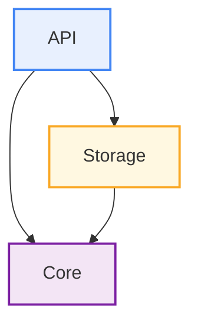
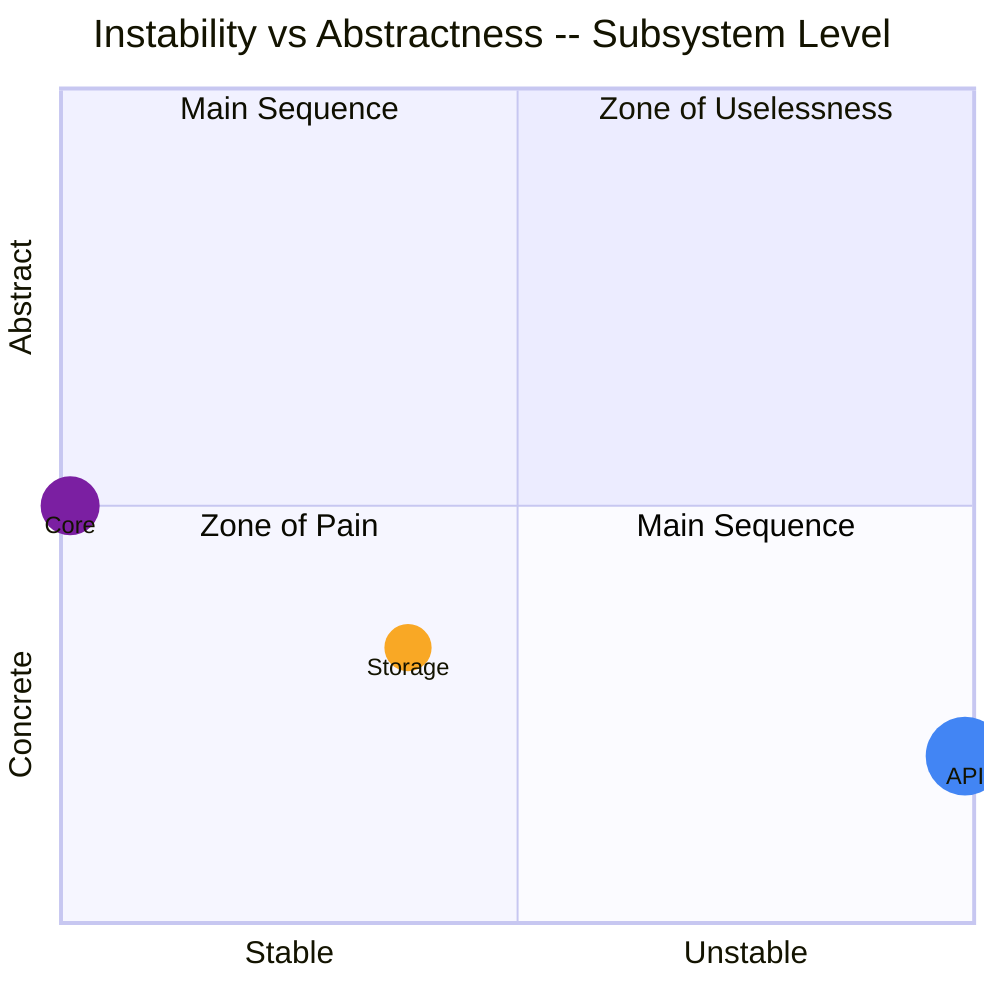
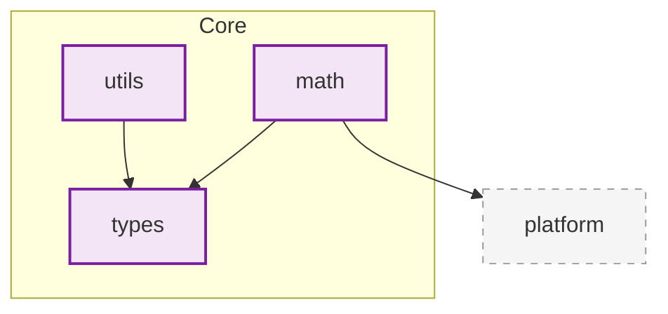

# Architecture Assessment Definition

Definition for writing architecture assessment documents. An arch-assessment is a living measurement of a component's structural health. It extracts the dependency graph, computes coupling and volatility metrics, detects structural problems (cycles, zone violations), and presents findings at three levels of detail. Its value is in the objective measurement -- the architecture as observed -- not in prescriptions for what to change.

---

## 1. Purpose

An arch-assessment exists to:

1. **Measure** -- extract the dependency structure and compute metrics that quantify coupling, abstractness, stability, and volatility.
2. **Surface** -- identify structural problems (cycles, zone violations, risk concentrations) unconditionally, regardless of whether they are new or previously reported.
3. **Orient** -- present the architecture at three levels of detail so that a reader can understand the system's structure from subsystem groupings down to individual build targets.
4. **Inform** -- provide the evidence that drives refactoring decisions. The assessment is the diagnostic report; briefs and plans are the treatment.

An arch-assessment is NOT:

- An arch-design. An arch-design defines the intended architecture -- types, contracts, decomposition. An arch-assessment measures the implemented architecture. They are complementary: the arch-design states intent; the assessment measures reality. See [Architecture Design Definition](arch-design_definition.md).
- A design study. A design study explores alternatives and converges on a recommendation. An assessment observes and reports. See [Design Study Definition](design-study_definition.md).
- A plan. A plan sequences implementation work. Findings in the assessment may motivate a plan, but the assessment does not prescribe how to address them. See [Implementation Plan Definition](impl-plan_definition.md).
- A one-time report. The assessment is a living document, regenerated and updated as the architecture evolves. If the assessment is stale, it is wrong.

---

## 2. Principles

### 2.1. Observation Over Prescription

The assessment reports what the architecture looks like and where it deviates from established principles (acyclic dependencies, layered structure, main-sequence proximity). It does not recommend specific fixes. "Planning and Pipeline have a bidirectional cycle" is a finding. "Move DeviceSpan to core" is a recommendation that belongs in a brief or plan.

If you find yourself writing "should," "consider," or "we recommend," you are writing a brief, not an assessment.

### 2.2. Unconditional Reporting

Every structural issue and every metric that crosses a concerning threshold is reported, regardless of whether it appeared in a previous assessment. The assessment is a snapshot of current health, not a delta from a previous snapshot. If a cycle existed last month and still exists, it appears. Filtering findings by novelty masks persistent problems.

### 2.3. Living Document

The assessment is updated when the architecture changes. Metrics are recomputed, diagrams are regenerated, and findings are re-evaluated against the current state. Like an arch-design, the assessment tracks the code; unlike a brief or plan, it is never archived while the component it describes is active.

### 2.4. Three-Level Hierarchy

Architectures are recursive. A system decomposes into subsystems, subsystems into packages, packages into targets. The assessment mirrors this structure, presenting the same categories of information (diagrams, metrics, findings) at each level. The global level gives the bird's-eye view; the subsystem and package levels give progressively finer detail.

### 2.5. Tool-Agnostic Format

The assessment defines what content must be present -- diagrams, metrics tables, findings -- not how that content is produced. The same document structure applies whether the content is generated by tooling, written by hand, or a combination. Tooling conventions (marker syntax, generation commands, injection pipelines) belong in companion skills or policies, not in this definition.

### 2.6. Scope Note

This definition is written for component-level assessments -- the scope that typically matches an arch-design. If the assessment targets a different scope (a single library, a full monorepo, a cross-cutting subsystem), the same principles and hierarchical structure apply. Adapt the level labels (global/subsystem/package) to match the natural decomposition of the target scope.

---

## 3. Document Map

An arch-assessment groups its sections into four layers:

| Layer | Sections | Purpose |
|---|---|---|
| **Framing** | Objective, Scope, Methodology | What is being assessed, what is excluded, and how the measurements are taken. |
| **Global** | Dependency Diagram, Metrics Table, Quadrant Chart, Findings | Bird's-eye view of the system's subsystem structure and health. |
| **Subsystem** | One section per subsystem: Dependency Diagram, Metrics Table, Quadrant Chart (optional), Findings | Per-subsystem view showing package-level structure. |
| **Package** | Selective sections for packages with findings: Metrics Table, Dependency Diagram (optional), Findings | Target-level detail for packages that warrant it. |

The Minimal Example (section 4) shows a complete arch-assessment following this structure. The remainder of this document specifies each section in detail.

---

## 4. Minimal Example

````markdown
---
title: Widget Service
status: current
date: 2026-05-15
author: Jane Smith
arch-design: widget-service_arch-design.md
---

# Widget Service

## 1. Objective

Assess the structural health of the widget service codebase (`widget/`) to surface dependency cycles, coupling problems, and high-risk packages.

## 2. Scope

| In scope | Out of scope |
|---|---|
| All non-test build targets under `widget/` | External dependencies (`@third_party`, `@platform`) |
| Internal dependency edges derived from build files | Runtime communication (RPC, topic, shared memory) |
| Martin coupling metrics and discounted volatility | Performance benchmarks, test coverage |

## 3. Methodology

**Metrics:**

| Metric | Definition |
|---|---|
| Ca (afferent coupling) | Count of external targets that depend on this node. |
| Ce (efferent coupling) | Count of external targets this node depends on. |
| I (instability) | Ce / (Ca + Ce). Range [0, 1]. 0 = maximally stable. |
| A (abstractness) | Header-only targets / total targets. Range [0, 1]. Proxy for interface-vs-implementation ratio. |
| D (distance from main sequence) | \|A + I - 1\|. Range [0, 1]. 0 = on the main sequence. |
| Discounted commits | Sum of gamma^(age_days) for each commit, gamma = exp(-ln(2)/half_life). |
| Change risk | (1 - I) * discounted_commits. Stable + volatile = high risk. |

Half-life: 90 days. Scope filtering: test targets and testonly libraries excluded.

**Finding thresholds:**

| Finding | Condition |
|---|---|
| Dependency cycle | Any cycle in the directed dependency graph (direct or multi-hop). |
| Zone of Pain | D > 0.3 and I < 0.3 (stable, concrete, hard to change). |
| Zone of Uselessness | D > 0.3 and I > 0.7 (unstable, abstract, possibly over-engineered). |
| High change risk | change_risk in the top 20% of all nodes at the same level. |
| Hub concentration | Ca exceeds 2x the mean Ca at the same level. |

## 4. Global Assessment

### 4.1. Dependency Diagram



### 4.2. Metrics

| Subsystem | Ca | Ce | I | A | D | Disc. Commits | Risk |
|---|---|---|---|---|---|---|---|
| Core | 12 | 0 | 0.00 | 0.50 | 0.50 | 4.2 | 4.2 |
| API | 0 | 8 | 1.00 | 0.20 | 0.20 | 6.1 | 0.0 |
| Storage | 5 | 3 | 0.38 | 0.33 | 0.29 | 2.8 | 1.7 |

### 4.3. Quadrant Chart



### 4.4. Findings

- **Zone of Pain: Core.** D=0.50, I=0.00, A=0.50. Maximally stable with moderate abstractness. Every change to Core ripples outward to 12 dependents. The 4 concrete targets (out of 8 total) are the coupling surface.

## 5. Subsystem: Core

### 5.1. Dependency Diagram



### 5.2. Metrics

| Package | Ca | Ce | I | A | D | Disc. Commits | Risk |
|---|---|---|---|---|---|---|---|
| types | 8 | 0 | 0.00 | 1.00 | 0.00 | 1.2 | 1.2 |
| utils | 3 | 1 | 0.25 | 0.00 | 0.75 | 1.8 | 1.4 |
| math | 1 | 2 | 0.67 | 0.50 | 0.17 | 1.2 | 0.4 |

### 5.3. Findings

- **Zone of Pain: utils.** D=0.75, I=0.25, A=0.00. Fully concrete and fairly stable. 3 dependents are exposed to every implementation change.

## 6. Package: Core/utils

### 6.1. Metrics

| Target | Ca | Ce | I | A | D |
|---|---|---|---|---|---|
| string_helpers | 2 | 1 | 0.33 | 0 | 0.67 |
| format | 1 | 0 | 0.00 | 0 | 1.00 |

### 6.2. Findings

- **Zone of Pain: format.** D=1.00, I=0.00, A=0.00. Maximally stable, fully concrete, no abstraction boundary. Any internal change affects its sole dependent.
````

---

## 5. Structure

Every arch-assessment follows this skeleton. Sections marked **(required)** must always be present. Sections marked **(when applicable)** are included when the content warrants them.

### 5.1. Metadata (required)

```markdown
---
title: <Component Name>
status: current | stale
date: YYYY-MM-DD
author: <git user name>
arch-design: <relative-path-to-companion-arch-design> (optional)
---
```

| Field | Purpose |
|---|---|
| `title` | Short, descriptive name. Matches the `#` heading. |
| `status` | `current` when the assessment reflects the code. `stale` when the code has diverged and the assessment needs regeneration. |
| `date` | Date of last regeneration in `YYYY-MM-DD` format. Updated on each regeneration, unlike other document types where the date is immutable. |
| `author` | Who owns this assessment. Use `git config user.name`. |
| `arch-design` | Optional. Relative path to the companion arch-design. Present when an arch-design exists for this component, absent otherwise. |

**File naming:** `<component-name>_arch-assessment.md`. No date prefix -- the assessment is a living document. E.g., `fallback-planner_arch-assessment.md`.

**Placement:** `docs/workflow/arch-assessments/`.

### 5.2. Objective (required)

One to three sentences answering: what component is being assessed, and what is the purpose of the assessment? Lead with the scope, not the method.

### 5.3. Scope (required)

What is included and what is excluded. Use a table. Typical exclusions: external dependencies, test-only targets, generated code, runtime communication patterns.

### 5.4. Methodology (required)

Declares the measurement approach so that findings are interpretable and the assessment is reproducible. Contains:

- **Metric definitions.** A table defining each metric used in the assessment. The minimum required set is the Martin coupling metrics: Ca, Ce, I (instability), A (abstractness), D (distance from main sequence). Additional metrics (volatility, derived risk scores, cohesion measures) are included with definitions when used.
- **Finding thresholds.** A table mapping each finding category to the condition that triggers it. Cycles have no threshold (always reported). Metric-based findings state the threshold value.
- **Scope filtering.** What is excluded from the graph and why (test targets, generated code, build infrastructure).
- **Regeneration.** How to reproduce the assessment. A command, a tool reference, or a description of the manual process. Sufficient for someone unfamiliar with the tooling to regenerate the content.

Terse when possible. Use tables for metrics and thresholds. Use prose when a metric or filtering decision needs explanation.

### 5.5. Global Assessment (required)

The bird's-eye view. Nodes are subsystems (or whatever the top-level grouping is for the assessed scope). Contains four subsections:

**5.5.1. Dependency Diagram (required).** A directed graph where nodes are subsystems and an edge from A to B means at least one target in A depends on a target in B. Bidirectional edges indicate cycles. Diagrams should use consistent color-coding per subsystem.

**5.5.2. Metrics Table (required).** One row per subsystem. Columns include at minimum: Ca, Ce, I, A, D. Additional columns for volatility and derived metrics when the methodology includes them.

**5.5.3. Quadrant Chart (required).** Instability (x-axis) vs Abstractness (y-axis) with one point per subsystem. The four quadrants are: Zone of Uselessness (high I, high A), Main Sequence (two quadrants along the diagonal), and Zone of Pain (low I, low A). Point size or annotation should encode a secondary dimension (e.g., volatility) when available.

**5.5.4. Findings (required).** A list of findings derived from the global-level metrics and structure. Every finding references the specific metric values or structural evidence that produced it. Finding categories:

| Category | What it means |
|---|---|
| Dependency cycle | A directed cycle exists in the dependency graph (direct: A to B to A, or multi-hop: A to B to C to A). Report the full path. |
| Zone of Pain | A node is stable and concrete (low I, low A, high D). Changes are expensive because many dependents are coupled to implementation details. |
| Zone of Uselessness | A node is unstable and abstract (high I, high A, high D). May indicate over-abstraction with no stable dependents. |
| High change risk | A node combines high stability with high recent volatility. Frequent changes to a stable node ripple outward. |
| Hub concentration | A single node has disproportionately high afferent coupling, creating a fragile center. |
| Layering violation | An edge runs against the intended dependency direction (when an arch-design or convention establishes a layering). |

If there are no findings at a level, state "No findings" rather than omitting the subsection.

### 5.6. Subsystem Sections (required)

One section per subsystem. Each subsystem section mirrors the global structure but one level down: nodes are packages within the subsystem, edges are inter-package dependencies.

Each subsystem section contains:

**Dependency Diagram (required).** Nodes are packages within the subsystem. Cross-subsystem dependencies appear as external reference nodes, visually distinguished from internal nodes (e.g., dashed borders, muted colors). The diagram shows the package-level structure including external dependencies without expanding their internals.

**Metrics Table (required).** One row per package within the subsystem. Same column set as the global metrics table.

**Quadrant Chart (when applicable).** Include when the subsystem has enough packages (roughly 4 or more) for the visualization to add value beyond the metrics table. Omit for subsystems with 1-2 packages where the table suffices.

**Findings (required).** Findings derived from the subsystem's package-level metrics and structure. Same finding categories as the global level, applied to the packages within this subsystem.

### 5.7. Package Sections (when applicable)

Package sections are included selectively -- only for packages that have findings worth surfacing at the target level. Healthy packages are adequately covered by their subsystem section's metrics table. A package section is warranted when:

- The package contains an internal cycle between targets.
- The package has a finding (Zone of Pain, high risk, hub concentration) and the target-level breakdown illuminates the cause.
- The package has enough internal structure that a target-level diagram adds understanding.

Each package section contains:

**Metrics Table (required when section is present).** One row per target within the package. At minimum: Ca, Ce, I, A, D.

**Dependency Diagram (when applicable).** Include when internal target structure has findings worth visualizing -- cycles between targets, unexpected coupling patterns. Omit when the metrics table alone tells the story.

**Findings (required when section is present).** Target-level findings within the package.

---

## 6. Document Lifecycle

| Status | Meaning | What changes |
|---|---|---|
| `current` | The assessment reflects the code. Metrics, diagrams, and findings are up to date. | Everything -- the document is regenerated as the architecture evolves. |
| `stale` | The code has changed since the last regeneration. The assessment may contain outdated metrics or missing findings. | Must be regenerated to return to `current`. |

The assessment has two statuses, not six. It is either accurate or it is not. There is no `draft`, `review`, or `approved` -- the assessment is a measurement, not a commitment. When the component is decommissioned, delete the assessment rather than archiving it (there is nothing to preserve -- the measurement has no value without its subject).

**Staleness detection:** an assessment becomes stale when the dependency graph of the assessed scope changes (targets added, removed, or re-wired). The definition does not prescribe how staleness is detected -- that is a tooling or process concern. The status field makes the state visible.

---

## 7. Relationship to Other Document Types

| Document type | Relationship |
|---|---|
| **Arch-design** | The arch-design defines the intended architecture; the assessment measures the implemented architecture. They are two views of the same component. When both exist, each links to the other via optional metadata fields. Discrepancies between them are findings in the assessment. |
| **Brief** | A brief may be written in response to assessment findings, framing the refactoring work that addresses them. The assessment provides evidence; the brief frames the response. |
| **Implementation plan** | A plan may reference assessment findings as motivation for its tasks. The assessment is not updated by the plan -- it is regenerated after the plan's work is complete. |
| **Design study** | When assessment findings reveal a structural problem with multiple possible solutions, a design study explores the alternatives. The assessment motivates the study; the study produces the approach. |

---

## 8. Anti-Patterns

| Anti-pattern | Problem | Fix |
|---|---|---|
| **Assessment as recommendation** | Document includes "should," "consider," or "we recommend" language. Prescribes fixes. | Remove prescriptions. State findings as observations with metric evidence. Recommendations belong in a brief. |
| **Filtered findings** | Only new or changed findings are reported. Persistent problems disappear from the document. | Report unconditionally. Every structural issue and concerning metric appears on every regeneration. |
| **Missing methodology** | Metrics appear without definitions or thresholds. Findings are unjustified. | Add the methodology section. Every finding must trace to a defined metric and threshold. |
| **Exhaustive package sections** | Every package gets its own section regardless of health. Document becomes hundreds of pages. | Package sections are selective. Include only packages with findings that warrant target-level detail. |
| **Stale assessment kept at current** | Code changed but the assessment was not regenerated. Metrics are wrong, findings are missing. | Transition to `stale`. Regenerate. |
| **Assessment without scope** | The document measures "the codebase" without declaring boundaries. Unclear what is included. | Declare scope explicitly. Name the root path, the exclusions, and the decomposition. |
| **Cycle reporting limited to direct pairs** | Only A-to-B-to-A cycles are detected. Multi-hop cycles (A-to-B-to-C-to-A) are missed. | Report all cycles in the directed graph, including multi-hop. State the full path for each. |

---

## Governing Standards

This definition conforms to the [Document Structure Standards](../standards/document-structure_standards.md). See section 2.1 for the file naming convention and date rules.
