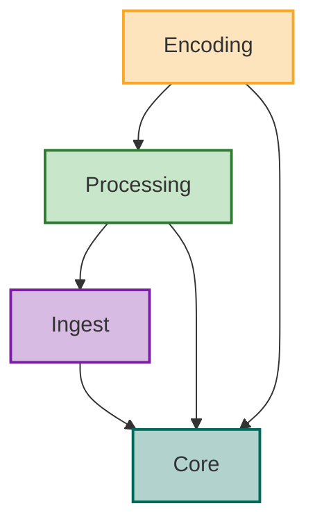
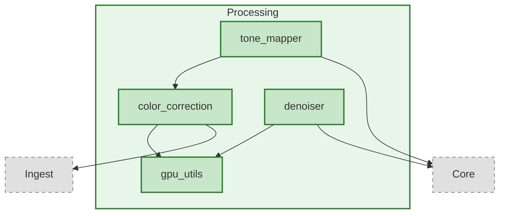
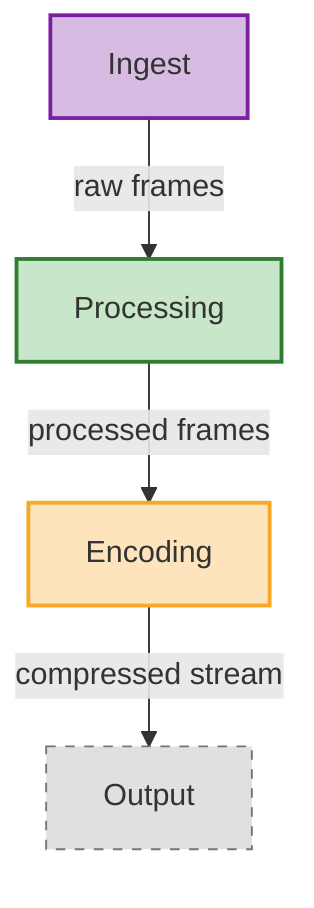
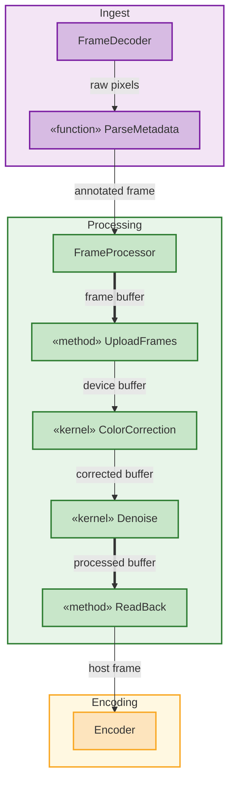

# Visual Vocabulary Standards

Standards for architectural diagrams used in documentation. Defines the entity taxonomy, visual channels, diagram types, and consistency rules that govern how software architecture is represented visually. Applies to all diagrams in arch-assessments, arch-designs, design studies, and briefs.

These standards define *what* to communicate and *how* to encode it visually. They do not mandate a specific rendering tool. Examples use mermaid for concreteness, but the conventions apply to any diagramming technology.

---

## 1. Entity Taxonomy

Architectural diagrams represent software structure at varying levels of detail. The taxonomy defines four well-known levels and a recursive extension mechanism.

### 1.1. Structural Hierarchy

| Level | Entity | Description |
|---|---|---|
| L0 | Source file | A single `.h`, `.cc`, `.cu`, `.py`, or equivalent source file. |
| L1 | Target | A compilation unit: the output of a single build rule (e.g., a `cc_library`, `cuda_library`, `py_library`). Contains one or more L0 files. |
| L2 | Package | A directory with a build file. Contains one or more L1 targets. |
| L3+ | Grouping | A named collection of L2 packages or L(N-1) groupings. Defined by the project -- typically by directory structure or a curated mapping. Recursive: a grouping can contain other groupings. |

Levels L0 through L2 are concrete and universal -- every build system has files, compilation units, and packages. L3+ is project-specific and recursive. A project with a shallow structure may have a single level of grouping. A large monorepo may have groupings of groupings (e.g., "Platform" containing "Networking" and "Storage" groupings, each containing packages).

The structural hierarchy applies directly to dependency diagrams. Data flow diagrams use a different entity model (section 3) but reference the structural hierarchy for containment.

### 1.2. Data Flow Entities

Data flow diagrams use two entity kinds:

| Entity | Description | Visual indicator |
|---|---|---|
| **Component** | An entity with runtime identity: a class instance, service, or module that owns state and orchestrates work. You could point at a running system and identify it. | Plain label |
| **Operation** | A function, method, or kernel that a component invokes. No independent runtime identity -- it exists as work performed by its owning component. | Stereotype prefix (section 1.3) |

An operation node must be inside the container of its owning component, or connected from it by an arrow. The reader infers ownership from containment or connectivity.

### 1.3. Stereotypes

Operations carry a stereotype label that names their execution mechanism. The label appears as a guillemet-wrapped prefix in the node text (e.g., `«function» ValidateInput`). Use the Unicode characters `«` (U+00AB) and `»` (U+00BB) -- the ASCII approximation `<<`/`>>` conflicts with shape delimiters in some diagramming tools.

**Seed inventory:**

| Stereotype | Meaning |
|---|---|
| `«kernel»` | GPU kernel launch (host-initiated, device-executed) |
| `«function»` | Free function or static method (CPU) |
| `«method»` | Instance method on a component (CPU) |

**Extension rule:** New stereotypes are permitted when no existing one accurately describes the execution mechanism. A stereotype must be a single noun naming *how* the operation executes, not *what* it computes. Examples of valid extensions: `«interrupt»`, `«coroutine»`, `«shader»`. Examples of invalid stereotypes: `«validator»`, `«parser»` (these name the business function, not the mechanism).

The stereotype set is open but grows slowly. Before adding one, check whether an existing stereotype covers the mechanism.

---

## 2. Visual Channels

Four visual channels encode architectural information. Their meanings are consistent across all diagram types.

### 2.1. Channel Definitions

| Channel | Encodes | Values |
|---|---|---|
| **Fill color** | Grouping ownership | Each grouping gets a unique color. All entities belonging to that grouping share its color. |
| **Border style** | Scope membership | **Solid** = internal (defined within the diagram's scope). **Dashed** = external reference (defined outside the diagram's scope, shown for context). |
| **Arrow weight** | Transport mechanism | **Thin** = normal data flow or dependency. **Thick** = hardware boundary crossing (host-to-device or device-to-host transfer). |
| **Stereotype text** | Execution mechanism | Guillemet-prefixed label on operation nodes (section 1.3). Absent on component nodes. |

### 2.2. Fill Color

Every entity inherits the fill color of its owning grouping. Color assignment must be consistent across all diagrams in a document set -- the same grouping always appears in the same color, whether in a dependency diagram or a data flow diagram.

Two tint levels distinguish entities from their containers:

| Element | Tint level | Purpose |
|---|---|---|
| Container background | Lighter | Provides a grouping boundary without competing with node fills. |
| Node fill | Darker | Makes nodes visually prominent within their container. |

The specific hex values are not standardized. What matters is the relationship: nodes are visibly darker than their container background, and the hue is consistent.

### 2.3. Border Style

Border style has one universal meaning across all diagram types:

- **Solid border**: the entity is defined within the diagram's scope. It is part of the system being documented.
- **Dashed border**: the entity is an external reference. It appears in the diagram to show a relationship, but its internals are out of scope.

External reference nodes should also use a muted or gray fill when they do not belong to any grouping shown in the diagram. When the external entity belongs to a grouping that has an assigned color, it should use that grouping's color with a dashed border.

### 2.4. Arrow Weight

- **Thin arrows** represent the default relationship type for the diagram: dependency edges in dependency diagrams, data flow in data flow diagrams.
- **Thick arrows** highlight hardware boundary crossings: host-to-device (H2D) or device-to-host (D2H) data transfers. Thick arrows are rare by design. A diagram dense with thick arrows is a flag -- it suggests excessive boundary crossing that may warrant architectural review.

Arrow weight applies only when the distinction is relevant. Diagrams that do not involve hardware boundaries use thin arrows exclusively.

### 2.5. Legend Requirement

Every diagram must include a legend that explains the visual encoding used in that diagram. The legend declares the meaning of fill colors, border styles, arrow weights, and any stereotypes present. Place the legend immediately after the diagram.

---

## 3. Diagram Types

### 3.1. Dependency Diagrams

Dependency diagrams show structural coupling: which entities depend on which others at compile time or build time. Arrows point from the dependent to the dependency (A --> B means "A depends on B").

#### 3.1.1. Levels

Each dependency diagram operates at one level of the structural hierarchy (section 1.1). A node at level N can be expanded into a separate diagram at level N+1.

| Level | Nodes are | Containers are | Scope |
|---|---|---|---|
| L3+ | Groupings | (none) | Full system |
| L2 | Packages | Grouping | One grouping from the level above |
| L1 | Targets | Package | One package from the level above |
| L0 | Source files | Target | One target from the level above |

At each level:

- **Internal nodes** are the entities within the scope. They have solid borders and the fill color of their owning grouping.
- **External reference nodes** represent entities outside the scope that participate in a dependency relationship with an internal node. They have dashed borders and the fill color of their own grouping.
- **Containers** (when present) group internal nodes by their parent in the hierarchy. One level of containment only -- never nest containers within containers.
- **Arrows** are thin and uniform. All arrows represent the same relationship (build dependency). There is no arrow weight distinction in dependency diagrams unless hardware boundary crossings are relevant to the dependency structure.

#### 3.1.2. Navigating Levels

Higher-level diagrams provide orientation; lower-level diagrams provide precision. A reader starts at the outermost grouping level to understand the system's coarse structure, then drills into a specific grouping to see its internal package structure, and so on.

Consistency between levels: every edge at level N must be traceable to at least one edge at level N-1. If grouping A depends on grouping B in the L3 diagram, at least one package in A depends on a package in B in the L2 diagram.

#### 3.1.3. Special Edge Styling

Cycle edges may be highlighted with a distinct color (e.g., red) and increased stroke width. This is the one exception to the uniform thin-arrow rule for dependency diagrams. Cycle highlighting is optional but recommended when cycles are present.

### 3.2. Data Flow Diagrams

Data flow diagrams show how data moves through the system at runtime. Arrows point in the direction of data movement, labeled with the data type or content being transferred.

This is a custom notation tailored to software architecture documentation. It is not a standard DFD (Yourdon-DeMarco or Gane-Sarson). It borrows selectively from DFD concepts while adapting them to the needs of code-level architectural communication.

#### 3.2.1. Levels

Data flow diagrams have two named levels:

| Level | Nodes are | Containers are | When to use |
|---|---|---|---|
| **Context** | Groupings | (none) | Orient the reader: which groupings exchange data, and what crosses the boundaries between them. |
| **Detail** | Components and stereotyped operations | Grouping | Show the transformation chain: how data is produced, transformed, and consumed within and across groupings. |

If a detail diagram exceeds approximately 9 process nodes, split it by grouping -- one detail diagram per grouping or per data flow path -- rather than adding a third level. The goal is readability, not completeness in a single diagram.

#### 3.2.2. Node Kinds

At the context level, nodes are groupings. They follow the same visual conventions as dependency diagram grouping nodes: fill color by grouping, solid border for in-scope, dashed border for external references.

At the detail level, nodes are either components or operations:

- **Components** are labeled with their name. They have solid borders (or dashed if external) and the fill color of their owning grouping.
- **Operations** are labeled with a stereotype prefix followed by their name. They have solid borders and the fill color of their owning grouping. Operations must be visually associated with their owning component -- either placed inside the same container or connected from the component by an arrow.

#### 3.2.3. Arrow Semantics

- **Thin labeled arrows** represent data flow. The label names the data being transferred (a type, a struct, a concept). Every arrow must have a label.
- **Thick labeled arrows** represent hardware boundary crossings (H2D or D2H). The label names the data being transferred. Use thick arrows only where the boundary crossing is architecturally significant.

Data stores (persistent or cycle-scoped buffers, databases, shared memory regions) may appear as nodes when their presence clarifies the data flow. They are not required. When included, they should be visually distinguished from process nodes (e.g., different shape or annotation).

#### 3.2.4. Containment

Detail-level data flow diagrams use one level of containment: grouping containers holding components and operations. Never nest containers. If a grouping has internal sub-structure that matters, create a separate detail diagram scoped to that grouping.

---

## 4. Cross-Diagram Consistency

### 4.1. Palette Consistency

The same grouping must appear in the same color across every diagram in a document set. A document set is all diagrams within a single document (e.g., an arch-design) and all related documents that a reader is expected to cross-reference (e.g., an arch-design and its companion arch-assessment).

When a project uses tooling to generate diagrams (e.g., extracting dependency graphs from build files), hand-authored diagrams in companion documents should use the same color assignments as the generated diagrams.

Palette consistency means:

- Same stroke color for the grouping's nodes and container borders.
- Same fill color derivation (darker for nodes, lighter for containers).
- Same color regardless of diagram type (dependency or data flow).

### 4.2. Border Consistency

Dashed borders mean the same thing in every diagram: the entity is an external reference, defined outside the diagram's scope. This meaning does not change between diagram types.

### 4.3. Arrow Consistency

Thick arrows mean hardware boundary crossing in every diagram where they appear. They do not encode other distinctions (urgency, volume, priority). If a diagram has no hardware boundary crossings, all arrows are thin.

---

## 5. Reference Examples

The examples below use a video processing system to illustrate each diagram type. The system has four groupings: Ingest (frame acquisition and decoding), Processing (CPU and GPU transforms), Encoding (output compression), and Core (shared utilities). Examples use mermaid syntax for concreteness.

### 5.1. Dependency Diagram -- Grouping Level (L3)

A top-level view showing groupings as nodes with build-time dependency edges. No containers at this level.

> [!NOTE]
> Nodes represent groupings. Arrows point from dependent to dependency. All nodes have solid borders (all are in scope). Colors are consistent per grouping.

### 5.2. Dependency Diagram -- Package Level (L2)

A per-grouping view showing packages as nodes inside a grouping container. External references from other groupings appear with dashed borders.

> [!NOTE]
> Internal packages have solid borders and Processing's green fill. External references have dashed borders and muted gray fill. The container uses a lighter tint of the grouping's color.

### 5.3. Data Flow Diagram -- Context Level

A high-level view showing data exchange between groupings.

> [!NOTE]
> Nodes represent groupings. Labeled arrows show what data crosses each boundary. All arrows are thin (no hardware boundary crossings at this level of abstraction). Output is an external entity (dashed border).

### 5.4. Data Flow Diagram -- Detail Level

A detailed view showing components and stereotyped operations within grouping containers. This example includes a host-to-device transfer highlighted with a thick arrow.

> [!NOTE]
> Components (`FrameDecoder`, `FrameProcessor`, `Encoder`) have plain labels. Operations carry stereotype prefixes: `«function»` for CPU free functions, `«method»` for instance methods, `«kernel»` for GPU kernel launches. Two thick arrows (`==>`) mark the hardware boundary crossings: host-to-device at `UploadFrames` and device-to-host at `ReadBack`. The arrow between `ColorCorrection` and `Denoise` is thin -- data stays on-device.

---

## 6. Anti-Patterns

| Anti-pattern | Problem | Fix |
|---|---|---|
| **Mixed abstraction levels** | A single diagram has grouping-level nodes alongside function-level nodes. The reader cannot tell what level of detail they are looking at. | Each diagram operates at one level. Use separate diagrams for different levels of detail. |
| **Nested containers** | Containers within containers. Layout engines struggle, and the reader loses track of the hierarchy. | One level of containment per diagram. Drill into a separate diagram for finer detail. |
| **Inconsistent palette** | The same grouping appears in different colors across diagrams. The reader must re-learn the color mapping for each diagram. | Assign colors to groupings once and use them everywhere in the document set. |
| **Overloaded border style** | Dashed borders mean "external reference" in one diagram and something else in another. | Dashed borders always mean external reference. Encode other distinctions via stereotypes or arrow weight. |
| **Dense thick arrows** | Every edge between hardware-accelerated operations is thick. The thick arrows lose their signal value. | Thick arrows are reserved for hardware boundary crossings (H2D/D2H). On-device edges are thin. |
| **Missing legend** | The diagram uses visual channels without explaining them. The reader guesses at meanings. | Every diagram has a legend immediately below it. |
| **Unlabeled arrows** | Data flow arrows without labels. The reader cannot tell what data is being transferred. | Every arrow in a data flow diagram must be labeled with the data type or content. |
| **Operations without ownership** | An operation node appears outside any container and unconnected from any component. The reader cannot tell who invokes it. | Operations must be inside their owning component's container or connected from it. |
| **Stereotype naming the business function** | `«validator»` or `«parser»` instead of `«function»`. The stereotype describes what the code does, not how it executes. | Stereotypes name the execution mechanism: `«function»`, `«kernel»`, `«method»`. |

---

## Governing Standards

This document conforms to the [Document Structure Standards](document-structure_standards.md). See section 2.3 for the doctype suffix inventory (`_standards`).